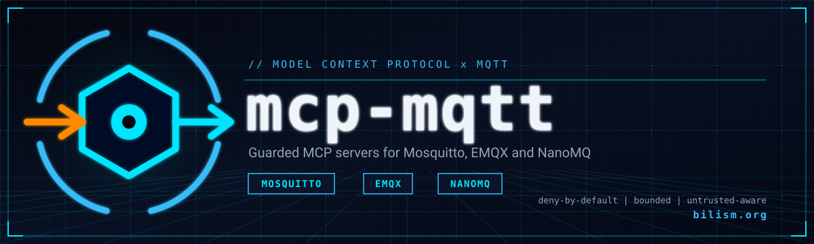

<p align="center">
  
</p>

<p align="center">
  <a href="https://bsommers.github.io/mcp-mqtt/"></a>
  
  
  
  
</p>

<p align="center">
  
  
  
  
  
  
</p>

# mcp-mqtt

Hardened [MCP](https://modelcontextprotocol.io) servers that let an LLM agent publish to and subscribe on
**Mosquitto**, **EMQX** and **NanoMQ** MQTT brokers, with deny-by-default authorization and bounded, untrusted-flagged output.

Site: <https://bsommers.github.io/mcp-mqtt/> · Part of [bilism.org](https://bilism.org) · Docs: [docs/](docs/README.md)

## Why mcp-mqtt

LLM agents increasingly need to observe and act on IoT, sensor and event systems, and MQTT is the common bus. A naive broker-to-LLM bridge is risky: unbounded payloads, wildcard subscriptions, prompt injection through message payloads, and credentials in tool parameters. We found no hardened MCP option for Mosquitto, EMQX and NanoMQ, so this project provides one.

Value: deny-by-default allowlists, size/count/rate bounds, inbound payloads flagged untrusted, one consistent tool surface across the three brokers plus broker-specific extras, and integration tests against real brokers.

Use cases: sensor monitoring and summarisation, incident triage from broker stats, controlled device commands over one allowlisted topic, home automation, NanoMQ edge deployments, dev/test of MQTT systems, and a read-only observability mode. Not for: general message routing, high-throughput streaming, long-lived subscriptions, or per-client authorization. Details: [docs/purpose.md](docs/purpose.md).

## Background

MQTT carries device telemetry and control. Handing an agent a raw MQTT client means it can publish anywhere,
subscribe to everything (`#`), flood the broker, and read attacker-controlled payloads as if they were instructions.
These servers expose a small tool surface where every guard lives server-side.

## Relationship to forge

[forge](https://github.com/bsommers/forge) generates MCP servers from OpenAPI specs only; MQTT is not OpenAPI, so these servers were
hand-written to follow forge's layout (one module per broker profile plus shared core) and the secure-design-patterns
MCP-001 (config from server env only), MCP-003 (dual-axis bounding), MCP-006 (stateless handlers) and MCP-008 (stdout is JSON-RPC only)
rules. The MQTT-specific guards (topic allowlists, payload caps, rate limit, untrusted-payload flagging) are additions.

## Architecture

```
 LLM / MCP client
        |  JSON-RPC over stdio (stdout = protocol only, logs -> stderr)
        v
 +-------------------------------+
 | brokers/{mosquitto,emqx,      |  per-broker entry point: shared tools + extras
 |          nanomq}.py           |
 +---------------+---------------+
                 v
 +-------------------------------+      +--------------------+
 | server.py  (tool handlers)    |<-----| config.py          |  MQTT_* env only
 |  rate limit -> guards -> I/O  |      +--------------------+
 +------+----------------+-------+
        | security.py    | client.py (paho-mqtt, one short-lived connection per call)
        | allowlists,    v
        | caps, flagging +--------> MQTT broker (TCP/TLS)
                         +--------> broker REST API (EMQX / NanoMQ extras, httpx)
```

## Tools

| Tool | Brokers | Purpose |
|---|---|---|
| `mqtt_publish` | all (absent if `MQTT_READ_ONLY=1`) | Publish to an allowlisted, wildcard-free topic |
| `mqtt_subscribe` | all | Collect up to N messages for up to T seconds on an allowlisted filter |
| `mqtt_get_retained` | all | Fetch retained messages matching a filter |
| `mqtt_policy` | all | Show active limits and allowlists (no secrets) |
| `mosquitto_sys_stats` | Mosquitto | Read `$SYS/broker/#` (needs `$SYS/#` in subscribe allowlist) |
| `emqx_stats`, `emqx_list_clients`, `emqx_list_subscriptions` | EMQX | Read-only REST API helpers |
| `nanomq_stats`, `nanomq_list_clients` | NanoMQ | Read-only REST API helpers |

## Configuration (environment)

| Variable | Default | Meaning |
|---|---|---|
| `MQTT_HOST` / `MQTT_PORT` | `localhost` / `1883` (`8883` with TLS) | Broker address |
| `MQTT_USERNAME` / `MQTT_PASSWORD` | unset | Credentials (refused over plaintext to non-loopback hosts) |
| `MQTT_TLS` | off | `1` enables TLS |
| `MQTT_TLS_CA` / `MQTT_TLS_CERT` / `MQTT_TLS_KEY` | unset | CA and client certificate files |
| `MQTT_TLS_INSECURE` | off | `1` disables certificate and hostname verification (requires `MQTT_TLS=1`) |
| `MQTT_PUBLISH_ALLOW` | empty (deny all) | Comma-separated topic patterns that may be published |
| `MQTT_SUBSCRIBE_ALLOW` | empty (deny all) | Comma-separated filters that may be subscribed; requested filters must be covered |
| `MQTT_READ_ONLY` | off | `1` removes `mqtt_publish` |
| `MQTT_ALLOW_RETAIN` | off | `1` permits retained publishes |
| `MQTT_MAX_QOS` | `1` | Highest QoS (0-2) |
| `MQTT_MAX_PUBLISH_BYTES` | `65536` | Publish payload cap |
| `MQTT_MAX_MESSAGE_BYTES` | `8192` | Per inbound message cap returned to the LLM |
| `MQTT_MAX_MESSAGES` | `100` | Messages per subscribe call |
| `MQTT_MAX_RESPONSE_BYTES` | `32768` | Total tool response budget |
| `MQTT_RATE_LIMIT_PER_MINUTE` | `60` | Tool calls per minute (process-wide) |
| `EMQX_API_URL`, `EMQX_API_KEY`, `EMQX_API_SECRET` | `http://localhost:18083` | EMQX REST access (server env only) |
| `NANOMQ_API_URL`, `NANOMQ_API_USER`, `NANOMQ_API_PASSWORD` | `http://localhost:8081` | NanoMQ REST access (server env only) |

## Security model

- **Deny by default**: empty allowlists permit nothing.
- **No wildcards or `$`-topics on publish**; subscribe filters must be covered by the allowlist (no `#` escalation).
- **Credentials never travel through tool inputs**; they come from the server environment only.
- **Bounds**: payload size, message count, per-message size, total response size, wait time, topic length/depth, QoS, rate limit.
- **Inbound payloads are untrusted**: returned in a structured field with `"untrusted": true`, truncated, and base64-encoded if binary. Treat as data, never instructions.
- **stdout is protocol-only**; logging goes to stderr as JSON.
- Tool handlers for publish/subscribe/retained/sys-stats are async and run broker I/O in worker threads, so a waiting `mqtt_subscribe` does not block other calls. (The EMQX/NanoMQ REST helpers and `mqtt_policy` are synchronous; REST calls block for at most 5 s.)

## Quickstart

```bash
uv sync
MQTT_HOST=localhost MQTT_PUBLISH_ALLOW='home/cmd/#' MQTT_SUBSCRIBE_ALLOW='home/#' uv run mcp-mosquitto
```

Register with Claude Code or Claude Desktop: see `examples/claude_code_mcp_add.sh` and `examples/claude_desktop_config.json`.
Client demos: `examples/01_publish_subscribe.py`, `02_sensor_telemetry.py`, `03_secure_policy_demo.py` (all take `--broker {mosquitto,emqx,nanomq}`).

## Documentation

| Doc | Contents |
|---|---|
| [docs/purpose.md](docs/purpose.md) | Why, value, use cases, when not to use |
| [docs/architecture.md](docs/architecture.md) | Components, flows, guard pipeline, threat model |
| [docs/running.md](docs/running.md) | Install and run |
| [docs/how-to.md](docs/how-to.md) | Recipes (Claude Code/Desktop, brokers, TLS, allowlists, read-only, limits) |
| [docs/usermanual/](docs/usermanual/README.md) | Install, config reference, tool reference, troubleshooting |
| [docs/SECURITY.md](docs/SECURITY.md) | Policy and honest limits |
| [docs/TESTING.md](docs/TESTING.md) | Tests and coverage caveat |

Also [CONTRIBUTING](CONTRIBUTING.md), [CHANGELOG](CHANGELOG.md), [LICENSE](LICENSE) (MIT).

## Testing

```bash
docker compose -f docker/docker-compose.yml up -d     # anonymous test brokers on 127.0.0.1:21883/21884/21885
uv run pytest                                          # unit + static gates
uv run pytest -m integration                           # stdio end-to-end against the live brokers
```

Integration tests skip a broker whose port is closed. Coverage under-reports broker/client code because the servers run in a subprocess ([docs/TESTING.md](docs/TESTING.md)). The compose brokers are for testing only (anonymous, loopback).

## Per-broker notes

- **Mosquitto**: `mosquitto_sys_stats` reads `$SYS/broker/#`; add `$SYS/#` to `MQTT_SUBSCRIBE_ALLOW` deliberately. Publishing to `$SYS` is always blocked.
- **EMQX**: create a read-only API key in the dashboard (Management > API Keys) and pass `EMQX_API_KEY`/`EMQX_API_SECRET` in the server env. Without them the REST helpers return an error; pub/sub still works.
- **NanoMQ**: enable the HTTP API (port 8081) and set `NANOMQ_API_USER`/`NANOMQ_API_PASSWORD`. Without them the REST helpers return an error; pub/sub still works.
