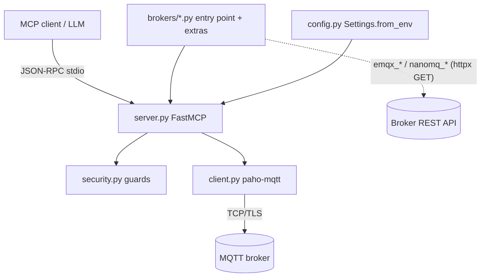
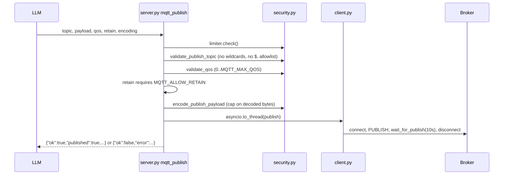
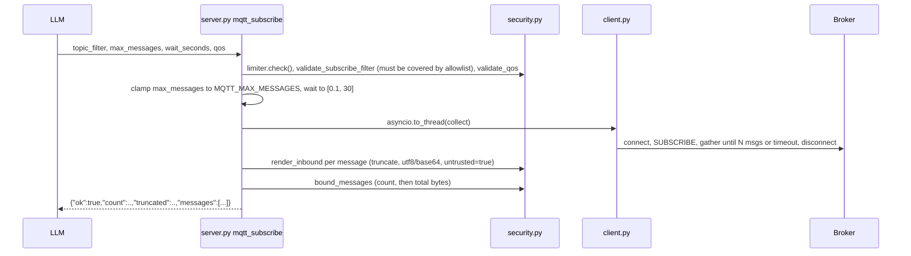
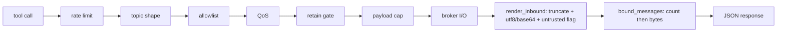

# Architecture

[← Back to Project README](../README.md) · [Docs index](README.md)

## Contents
- [Components](#components)
- [Request flow](#request-flow)
- [Security guard pipeline](#security-guard-pipeline)
- [Concurrency model](#concurrency-model)
- [Threat model](#threat-model)

## Components

```
 LLM / MCP client
        |  JSON-RPC over stdio (stdout = protocol only, logs -> stderr)
        v
 +-------------------------------+
 | brokers/{mosquitto,emqx,      |  entry points (mcp-mosquitto / mcp-emqx / mcp-nanomq):
 |          nanomq}.py           |  shared tools + broker-specific extras
 +---------------+---------------+
                 v
 +-------------------------------+      +--------------------+
 | server.py  (tool handlers)    |<-----| config.py          |  MQTT_* env only, validated at start
 |  rate limit -> guards -> I/O  |      +--------------------+
 +------+----------------+-------+
        | security.py    | client.py (paho-mqtt, one short-lived connection per call)
        | allowlists,    v
        | caps, flagging +--------> MQTT broker (TCP/TLS)
                         +--------> broker REST API (EMQX / NanoMQ extras, httpx, read-only GET)
```



| Module | Role |
|---|---|
| `src/mcp_mqtt/config.py` | Frozen `Settings` dataclass built by `Settings.from_env()`; `validate()` fails fast at startup |
| `src/mcp_mqtt/security.py` | Pure guards: topic validation, `topic_matches`, `filter_covered_by`, QoS check, payload encode/cap, `RateLimiter`, `render_inbound`, `bound_messages` |
| `src/mcp_mqtt/client.py` | `publish()` and `collect()` over paho-mqtt; raises `BrokerError` |
| `src/mcp_mqtt/server.py` | `build_server()` registers `mqtt_publish` (unless read-only), `mqtt_subscribe`, `mqtt_get_retained`, `mqtt_policy`, then calls the broker `extras` hook; `run()` starts stdio |
| `src/mcp_mqtt/brokers/*.py` | Per-broker `extras()` and `main()` |

## Request flow

### Publish



### Subscribe



## Security guard pipeline

```
 request ──> rate limit ──> topic shape ──> allowlist ──> QoS ──> retain ──> payload cap ──> I/O
             (token         (non-empty,    (publish:      (0..    (opt-in)   (decoded         (short-lived
              bucket)        no control     pattern match; max_qos)           bytes)           connection)
                             chars, <=256   subscribe:
                             bytes, <=16    filter covered
                             levels, '#'    by entry)
                             / '+' placement)

 response <── bound_messages <── render_inbound <── broker messages
              (count, bytes)     (truncate, utf8|base64, untrusted=true)
```



Any `GuardError` or `BrokerError` becomes `{"ok": false, "error": "..."}`; the messages are written to be safe to show the model.

## Concurrency model

Tool handlers (`mqtt_publish`, `mqtt_subscribe`, `mqtt_get_retained`, `mosquitto_sys_stats`) are `async` and run the blocking paho calls with `asyncio.to_thread`, so one server process can serve a publish while another call is waiting in a subscribe. No two-process workaround is needed. The rate limiter is one process-wide, thread-safe token bucket. `mqtt_policy` and the EMQX/NanoMQ REST helpers are plain synchronous handlers; a REST call blocks the event loop for at most its 5 s HTTP timeout.

## Threat model

```
  attacker-controlled                 trusted boundary (server process)             trusted infra
 +--------------------+            +----------------------------------+         +-------------+
 | device / client    |--publish-->|                                  |         |             |
 | writes payloads to |  broker    |  render_inbound: bound + label   |<--sub---|   MQTT      |
 | allowed topics     |----------->|  untrusted, never interpreted    |         |   broker    |
 +--------------------+            |                                  |--pub--->|             |
 +--------------------+            |  guards: allowlist, caps, rate   |         +-------------+
 | LLM (may be        |--tools---->|  config: env only                |
 | manipulated)       |<-JSON------|                                  |
 +--------------------+            +----------------------------------+
```

| Threat | Mitigation | Residual risk |
|---|---|---|
| Prompt injection via broker payloads | Payload returned only inside a structured `payload` field with `"untrusted": true`; truncated to `MQTT_MAX_MESSAGE_BYTES`; binary/control-char data base64-encoded; tool descriptions tell the model it is data | Flagging is advisory: a model that obeys text inside a `payload` field can still be misled. Use read-only mode and narrow allowlists so a hijacked model has little to act on |
| Agent publishes to command topics it should not | Publish allowlist, deny-by-default; no wildcards; no `$` topics | Allowlisted topics are fully writable by the model |
| Agent reads everything (`#`) | Subscribe filter must be covered by an allowlist entry; a `$`-prefixed filter needs an allowlist entry that itself starts with `$` | Allowlisted topics are fully readable |
| Flooding / resource exhaustion | Rate limit, message count, per-message and total byte caps, wait cap, topic length/depth, publish cap, per-message cap at receive time | Limits are per process; several processes multiply them |
| Credential theft via tool inputs | Credentials only in server env; static gate fails tests if a tool parameter is named like a credential | Anyone who can read the server's env or process list sees them |
| Credentials on the wire | `validate()` refuses a password over plaintext to a non-loopback host | Username-only auth, or loopback plaintext, is not blocked |
| Corrupting the MCP channel | No `print`; stdout is JSON-RPC only; logs on stderr | n/a |
| SSRF via REST helpers | URL fixed by server env (`EMQX_API_URL`, `NANOMQ_API_URL`), http(s) only, no redirects, GET only, response capped | Operator-supplied URL is trusted |
